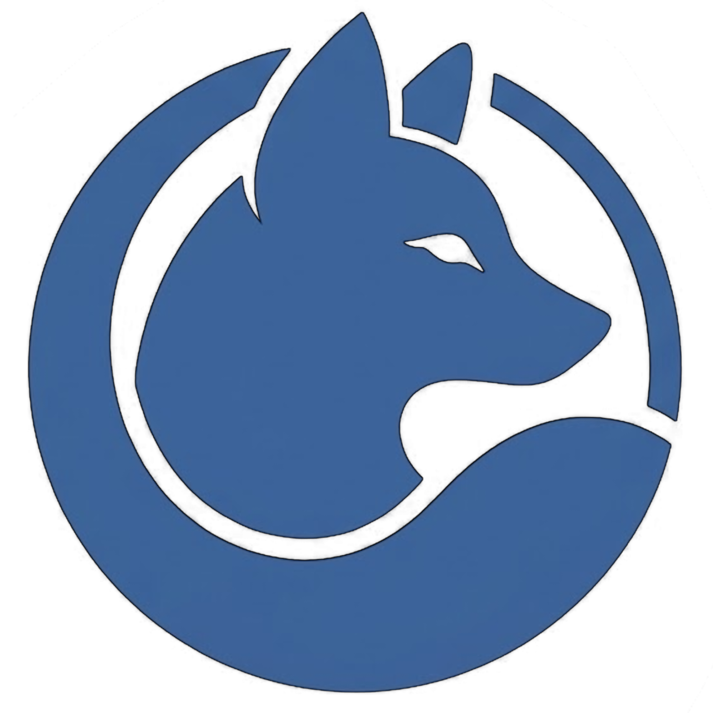

<div align="center">



# 🦊 LieCord

### The privacy-first, ultra-fast and modern cross-platform communication hub.

[](https://cord.lie2srvv.com)
[](https://cord.lie2srvv.com/downloads)
[](LICENSE)
[](https://cord.lie2srvv.com)

[**🌐 Open Web App**](https://cord.lie2srvv.com) • [**📥 Download Clients**](https://cord.lie2srvv.com/downloads) • [**📖 Documentation**](#-architecture--repository-layout)

</div>

---

## ✨ Overview

**LieCord** is an open-source, highly responsive communication platform engineered for seamless voice, video, text, and screen sharing across all operating systems. 

Built on a hardened distributed microservices architecture, LieCord gives users total ownership over their identity, messages, and calls without telemetry, forced ads, or corporate tracking.

---

## 🚀 Key Features

### 🎧 Voice & Ultra-HD Screen Sharing
- **Adaptive WebRTC Engine**: Powered by LiveKit & Vortex with intelligent bitrate scaling.
- **Crystal Clear Screen Sharing**: Resolutions from **480p up to UHD 4K (60 FPS)** with desktop audio capture on Linux (PipeWire/PulseAudio), Windows, and macOS.
- **Bandwidth Optimization**: Automatic freeze-frame snapshots for inactive streams, on-demand video subscription, and zero frame-dropping preview modes.
- **Voice Clarity**: Integrated smart noise gating, high-pass filtering, and typing noise suppression.

### 🖼️ Next-Gen Media Engine
- **Full Video & Animated Avatars**: Seamless support for MP4, MOV, WEBM, and GIF profile pictures and banners with automatic infinite-loop WebP server transcoding.
- **In-App Media Crop**: Interactive framing tool for avatars (1:1) and server/profile banners (16:9 / 3.6:1).
- **Smooth Image & Video Viewer**: Fullscreen viewer with double-click zoom, touch pinch-to-zoom, pan, rotation, and high-DPI scaling.

### 📱 True Cross-Platform Ecosystem
- **Web App**: Single-Page Application with responsive navigation, gesture sheets, and zero-latency WebSocket sync.
- **Desktop (Linux / Windows / macOS)**: Native Electron client with custom graphite titlebars, D-Bus notification avatars, system tray minimization, and hardware acceleration.
- **Android**: Modern Jetpack Compose native application featuring background WebSocket push sync (`LieCordPushService`), high-priority call ringing (`CallNotificationManager`), and screen streaming foreground service.

### 🔒 Privacy & Defense-in-Depth
- **End-to-End Encryption (E2EE)**: Direct messaging client-side encryption.
- **Hardened Edge**: Reverse proxy secured with Strict-Transport-Security (HSTS), strict Content-Security-Policy (CSP), framing restrictions, and authenticated session tokens.
- **No Secret Leaks**: Production configurations and encryption keys are strictly decoupled from source code.

---

## 🏗 Architecture & Repository Layout

```text
LieCord/
├── 🌐 web/                  # Web Client (Preact + TypeScript + MobX + SCSS)
│   ├── src/controllers/     # Modals, Sessions, and State Management
│   ├── src/lib/vortex/      # WebRTC Voice & Screen Sharing Engine
│   └── src/pages/           # Chat, Voice, Server & Settings views
├── 💻 desktop/              # Desktop App (Electron Forge + TypeScript + Vite)
│   ├── src/native/          # OS-level Tray, D-Bus Notifications & Windowing
│   └── assets/              # App icons (PNG, ICO, ICNS)
├── 📱 android/              # Android App (Kotlin + Jetpack Compose + WebRTC)
│   ├── app/src/main/java/   # Push services, Call action receivers & Screens
│   └── app/build.gradle.kts # Dynamic keystore signing pipeline
├── ⚙️ server/               # Infrastructure & Backend Configs
│   ├── Caddyfile            # Hardened edge routing, SSL, CSP & HSTS
│   ├── media_proxy.py       # High-performance media transcoding proxy (FFmpeg)
│   └── compose.yml          # Containerized microservice orchestration
└── 🤖 .github/workflows/    # Automated CI pipelines (Android APK, macOS, Windows)
```

---

## 🛠 Getting Started

### Prerequisites
- **Node.js**: `v20.x` or `v22.x`
- **Yarn**: `3.x+`
- **Python**: `3.10+` (for server utilities and media proxy)
- **FFmpeg**: (with `libwebp` support for media transcoding)

### 1. Web Client
```bash
cd web
yarn install
yarn dev
```
Open [http://localhost:5000](http://localhost:5000) to view the client.

### 2. Desktop Client
```bash
cd desktop
npm install
npm start
```
To package installers for your operating system:
```bash
npm run make
```

### 3. Android Client
Ensure Android SDK is configured, then build the APK:
```bash
cd android
./gradlew assembleDebug
```
The output APK will be generated at `android/app/build/outputs/apk/debug/app-debug.apk`.

---

## 📦 Downloads & Web Access

Official builds and client downloads are available directly at:
👉 **[https://cord.lie2srvv.com/downloads](https://cord.lie2srvv.com/downloads)**

- 🐧 **Linux**: `.deb`, `.AppImage`
- 🪟 **Windows**: `.exe` (Installer & Standalone ZIP)
- 🍏 **macOS**: `.dmg` (Apple Silicon & Intel)
- 🤖 **Android**: `.apk`

---

## 📄 License

This project is licensed under the **GNU Affero General Public License v3.0 (AGPL-3.0)**. See the [LICENSE](LICENSE) file for full details.

<div align="center">
<sub>Crafted with passion by <a href="https://github.com/lie2srvv">lie2srvv</a>.</sub>
</div>
